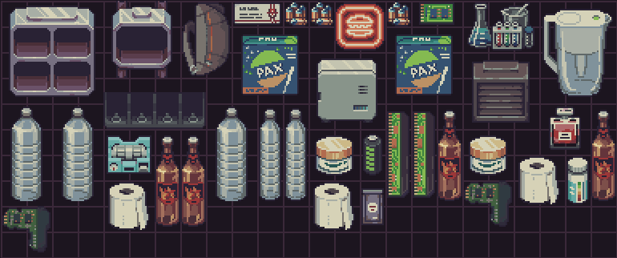
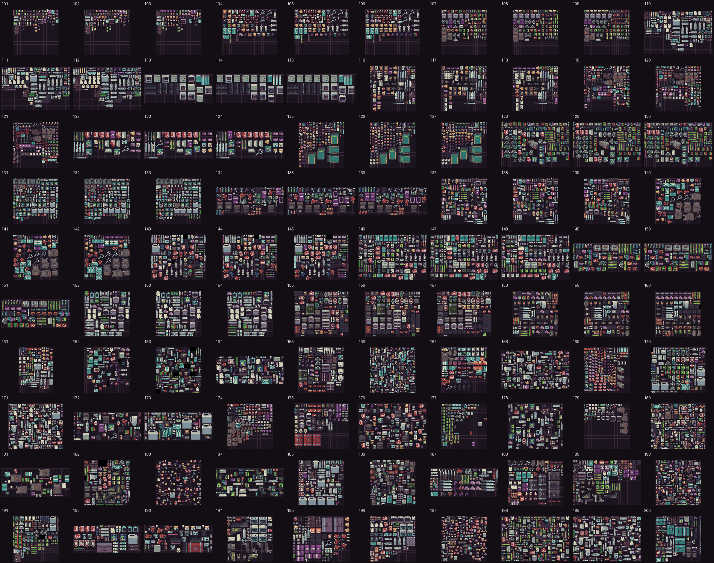

# SmartInventoryArrange Resources

Probably Stolen Demo 的离线库存渲染资源、物品元数据和布局测试集。用于从 SmartInventoryArrange 日志还原仓库/背包/容器布局，离线比较排序算法，无需每次进入游戏。

## 许可证与素材范围

本项目可授权的原创代码采用 **[MIT License](LICENSE)**；具体文件范围见 [LICENSE_SCOPE.md](LICENSE_SCOPE.md)，第三方依赖见 [THIRD_PARTY_NOTICES.md](THIRD_PARTY_NOTICES.md)。**游戏图片、游戏导出数据和第三方组件不随本项目改为 MIT。** 游戏素材再分发的明确授权仍待核实；公开仓库和标注出处不等于取得授权。

## 与智能排列算法的关系

本仓库是 **[SmartInventoryArrange 智能排列 Mod](https://github.com/xiepeixuan/SmartInventoryArrange)** 的公开离线素材与测试资源库。

算法研发先利用本库的贴图、真实占格、合法方向和测试输入，在游戏外生成、校验、渲染与比较候选布局；结合人工偏好标注进行可解释偏好模型的训练、校准和离线回归，不需要每次试验都实际进入游戏。离线结果准备好后，再构建 DLL 进入游戏验证实际排列、原生 API、事务提交和回滚。

本库不是排序算法或训练系统，贴图也不会自行训练装箱；候选生成和安全约束由算法代码负责。离线通过与游戏内通过分别记录，最终仍以游戏内验证为准。

## 内容

| 内容 | 数量/说明 |
| --- | --- |
| 原版物品元数据 | 325 个 ItemId，游戏版本 0.46D |
| Sprite PNG | 1155 张，目录中每个物品均有渲染映射 |
| 测试输入 | 200 个 TXT |
| 预生成布局 | 200 张 PNG 及 200 份渲染 JSON |
| 测试物品实例 | 20020 件，覆盖304种 ItemId、34种类型、32种尺寸 |
| Windows 渲染器 | SmartLayoutRenderer.exe |
| Python 源码 | tools/layout_renderer_app.py |

上述数字来自已有资源清单和离线验证报告，不代表游戏中每种排列都经过人工美观验证。

## 预览

最新布局示例：



第101–200组总览（点击图片查看原图）：



[全部200组总览](test_sets/overview_all_200.png)

## 下载与目录结构

在 GitHub 点击 **Code → Download ZIP**，解压整个目录；也可以：

```powershell
git clone https://github.com/xiepeixuan/SmartInventoryArrange-Resources.git
cd SmartInventoryArrange-Resources
```

本仓库公开，可直接下载 ZIP 或克隆，无需申请访问权限。不要只下载 EXE；必须同时保留 catalog 和 sprites。

```text
SmartInventoryArrange-Resources/
├── SmartLayoutRenderer.exe
├── README.md
├── catalog/
│   └── items-renderer.json
├── sprites/                      # 原版物品图片
├── renders/                      # 最新布局示例
├── test_sets/                    # 输入、渲染图、报告和清单
│   ├── test_*.txt
│   ├── test_*.layout.png
│   ├── test_*.layout.json
│   ├── manifest_all_200.json
│   ├── verification_101_200.json
│   └── overview_all_200.png
└── tools/
    ├── layout_renderer_app.py
    └── requirements.txt
```

本仓库不是 MelonLoader Mod，不需要放进游戏 Mods 目录；无需安装游戏才能使用已有资源渲染。

## 方法一：Windows EXE

1. 将含 Smart Arrange Result 的 TXT 或 LOG 拖到 SmartLayoutRenderer.exe。
2. 或双击 EXE，在文件选择器中选择输入。
3. 程序读取最后一个结果区块，生成图片并自动打开。

输入 `C:\layouts\sample.txt` 后输出：

```text
C:\layouts\sample.layout.png
C:\layouts\sample.layout.json
```

命令行无窗口提示、不开图：

```powershell
.\SmartLayoutRenderer.exe .\test_sets\test_101_pair_01_30x30_40pct_messy.txt --no-open --quiet
```

PowerShell 中如需等待 GUI 程序退出、检查退出码，使用 Start-Process：

```powershell
$p = Start-Process -FilePath '.\SmartLayoutRenderer.exe' `
  -ArgumentList @('.\test_sets\test_101_pair_01_30x30_40pct_messy.txt', '--no-open', '--quiet') `
  -Wait -PassThru
$p.ExitCode
```

## 方法二：Python 源码

安装 Python 3.10 或更新版本，然后：

```powershell
python -m venv .venv
.\.venv\Scripts\python.exe -m pip install -r .\tools\requirements.txt
.\.venv\Scripts\python.exe .\tools\layout_renderer_app.py `
  .\test_sets\test_101_pair_01_30x30_40pct_messy.txt `
  --resources . --no-open --quiet
```

源码默认资源路径是 tools 目录，因此源码调用应显式传 `--resources .`，且当前工作目录为仓库根目录。跨平台命令行应同时使用 `--no-open --quiet`，以避开 Windows 文件选择器和消息框。

可选参数：

| 参数 | 说明 |
| --- | --- |
| input | TXT/LOG 路径 |
| --resources | 资源根目录，包含 catalog 和 sprites |
| -o / --output | 自定义输出 PNG 路径 |
| --scale | 缩放倍数，默认2；每格原生16像素，默认输出32像素 |
| --no-open | 不自动打开生成图片 |
| --quiet | 不弹出成功消息框 |

## 输入日志格式

```text
========== Smart Arrange Result ==========
Time: 2026-10-13 04:24:00.726
Outcome: applied
ContainerSize: 24x10
[001] Name: bottled_water | ItemId: bottled_water | Coordinate: (11,4) | Size: 1x4 | Type: WATER | Orientation: 0
[002] Name: storage_bay | ItemId: storage_bay | Coordinate: (0,0) | Size: 3x3 | Type: STORAGE | Orientation: 0
========== Result End ==========
```

- 坐标从0开始，左上角为 `(0,0)`，X向右、Y向下。
- Size 是最终方向下的占格宽高，而非未旋转的基础尺寸。
- 每个物品实例各占一行；相同 ItemId 可以出现多次。
- 保留示例中的字段名称、分隔符和顺序，解析器按此格式识别。
- 可选行尾 `| Status: fixed` 表示固定物品。
- 同一文件有多个结果区块时，只渲染最后一个。
- 当前解析器要求至少一个物品行，空容器输入不受支持。

### 方向映射

| Orientation | 图片变换 |
| --- | --- |
| 0 | 原方向 |
| 1 | 逆时针90° |
| 2 | 180° |
| 3 | 顺时针90° |

不要把方向1和3反过来。渲染器按最终 Size 缩放旋转后的图片，不再交换日志中的宽高。

## 物品目录

`catalog/items-renderer.json` 包含 ItemId、显示名称、目录类、结构化 itemTypes、主类型、各方向宽高、真实占格mask及Sprite文件映射等信息。

应优先用 ItemId 关联图片，用结构化分类研究算法；本地化名称不作为唯一分类依据。1155张Sprite并不等于1155种物品；已映射的原版物品为325个。

## 测试集

- 第1–30组：基础和边界场景。
- 第31–100组：以20x20以上、70%–95%占用率场景为主。
- 第101–200组：60组成对布局（20份物品集合各有无序、部分有序、有序版本），另40组独立压力场景。
- 新100组包含8组不规则mask和10组固定障碍，实际占用率38%–98%。

第101–200组目标占用率分布：

| 目标占用率 | 数量 |
| --- | --- |
| 30%–49% | 5 |
| 50%–69% | 10 |
| 70%–79% | 20 |
| 80%–89% | 30 |
| 90%–95% | 30 |
| 96%–98% | 5 |

目标密度不一定等于真实mask密度；比较实际占用率时优先读取 `trueMaskDensity`。`Status: fixed` 是测试数据标记，渲染器仅显示图片，不执行排列或模拟事务。

完整清单见 [manifest_all_200.json](test_sets/manifest_all_200.json)，新增组验证见 [verification_101_200.json](test_sets/verification_101_200.json)。

### 用于算法研发

1. 读取TXT及catalog，建立纯数据库存模型。
2. 保留物品多重集合、固定格、合法方向和真实mask。
3. 运行算法，输出同格式的新TXT到独立目录，避免覆盖基准输入。
4. 渲染原布局和候选布局，进行A/B比较。
5. 用独立校验器检查数量、重叠、边界、方向和固定状态。

本渲染器只画图，**不会验证布局是否合法，不是排序算法或训练系统**。

如果划分训练/验证/测试集，同一物品集合的派生布局必须留在同一分区，特别是第101–160组成对样本。建议按容器、物品多重集合和障碍布局分组，而不是随机按图片分割。

## 输出JSON与常见问题

- JSON包含 sourceLog、output、containerSize、outcome、itemCount、missingSprites、cellPixels。
- `missingSprites` 非空：ItemId未收录或图片文件缺失；Mod新增物品需要自行补充映射和图片。
- 没有找到结果区块：检查标题和字段格式。
- 宽高或朝向不对：检查日志中的最终Size与Orientation，不要预先重复旋转图片。
- 物品互相遮挡：渲染器按输入索引覆盖绘制；应单独检查坐标和真实mask合法性。
- 某些报告保留生成时的本机绝对路径，仅用于溯源，运行时不依赖那些历史路径。

## 已有验证与限制

- 现有200组已有预生成PNG/JSON；第101–200组自动渲染验证记录的缺失图片数为0。
- 原有工具验证记录中，第101组EXE渲染与源码输出哈希一致。
- 新环境请先选一组TXT重新渲染，检查JSON的missingSprites。
- 输出是格子和物品Sprite的离线还原，不包含完整游戏UI、悬停、动画、耐久条和其他动态覆盖层。
- 本仓库不包含游戏程序集、游戏存档或完整安装包。
- 图片和游戏数据来自Probably Stolen；游戏素材权利归原权利人。仓库未为游戏素材授予额外再分发许可。
